# vitest-auto-spy

[English README](./README.md) · [Документация](https://asdalexey.github.io/vitest-auto-spy/ru/) · [История изменений](./CHANGELOG.md)

Создайте спай из класса одной строкой и передайте его вместо зависимости. `createSpyFromClass()` берёт методы и их типы из класса, поэтому для каждого метода не нужно писать свой `vi.fn()`. Настоящий конструктор при этом не запускается.



## Первый тест

В проекте с Vitest установите библиотеку как зависимость для разработки:

```bash
npm i -D vitest-auto-spy
```

В этом тесте настоящий `UserService` загружает пользователя через подменённый `ApiService`. Скопируйте пример в `user.spec.ts`:

```ts
import { expect, it } from 'vitest';
import { createSpyFromClass } from 'vitest-auto-spy';

class ApiService {
  async get(url: string): Promise<{ id: number; name: string }> {
    const response = await fetch(url);
    return response.json();
  }
}

class UserService {
  constructor(private readonly api: ApiService) {}

  load(id: number) {
    return this.api.get(`/users/${id}`);
  }
}

it('loads a user', async () => {
  const api = createSpyFromClass(ApiService);
  api.get.resolveWith({ id: 1, name: 'Ada' });

  const user = await new UserService(api).load(1);

  expect(user.name).toBe('Ada');
  expect(api.get).toHaveBeenCalledWith('/users/1');
});
```

Запустите `npx vitest run user.spec.ts`. `resolveWith()` задаёт результат асинхронного метода, а `toHaveBeenCalledWith()` проверяет адрес. Сеть не нужна: настоящий `ApiService.get()` не вызывается.

## Angular: подмена через TestBed

Когда Angular сам создаёт сервис, используйте `provideAutoSpy()` в `providers`. Получите тот же спай через `injectSpy()` и настройте его до вызова проверяемого кода.



См. [полный пример с TestBed](https://asdalexey.github.io/vitest-auto-spy/ru/adapters/angular) и [рецепты тестов Angular](https://asdalexey.github.io/vitest-auto-spy/ru/recipes).

## Куда дальше

- **Только тип или интерфейс, без класса:** [создайте спай через `createAutoMock<T>()`](https://asdalexey.github.io/vitest-auto-spy/ru/core/auto-mock-by-type).
- **Разные ответы для разных аргументов:** [задайте правила через `calledWith()`](https://asdalexey.github.io/vitest-auto-spy/ru/core/control-helpers).
- **Забыли настроить метод:** [включите строгий режим, чтобы получить ошибку вместо `undefined`](https://asdalexey.github.io/vitest-auto-spy/ru/core/strict-mode).
- **Другой раннер:** [выберите импорт для Bun, node:test или Rstest](https://asdalexey.github.io/vitest-auto-spy/ru/core/installation).
- **Переходите с Jest или Jasmine:** [перенесите существующие тесты](https://asdalexey.github.io/vitest-auto-spy/ru/migrating).
